# OpenGameArt: Quaternius 3D art

**52 assets from [OpenGameArt](https://opengameart.org), dedicated to the public domain under [CC0](https://creativecommons.org/publicdomain/zero/1.0/).** Use them in any game, free or paid, and change them however you like; no credit is needed.

3D art from OpenGameArt entries licensed CC0 (some also offer other licences; CC0 is the one that applies here). 2.0 GB in all.

This is a copy kept by [zuujis-cc0](https://github.com/zuujis-cc0) so game makers can take single files from GitHub. It is not made by or affiliated with OpenGameArt: the originals, often in more formats and higher resolutions, are on [opengameart.org](https://opengameart.org). If they help you, consider [supporting OpenGameArt](https://opengameart.org/content/faq).

Every file is listed in [MANIFEST.tsv](MANIFEST.tsv) with its size and SHA-256. More free assets: [the Zuujis collection](https://github.com/zuujis-cc0/free-game-assets#readme).

| | | | |
| :-: | :-: | :-: | :-: |
| <a href="5-low-poly-animals">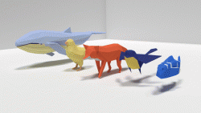</a> <b><a href="5-low-poly-animals">5 Low poly animals</a></b> by quaternius · <a href="https://opengameart.org/content/5-low-poly-animals">source</a> |  <b><a href="5-low-poly-trees">5 low poly trees</a></b> by quaternius · <a href="https://opengameart.org/content/5-low-poly-trees">source</a> | <a href="animated-animales-low-poly">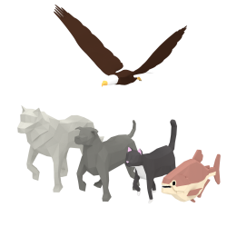</a> <b><a href="animated-animales-low-poly">Animated Animales Low Poly</a></b> by quaternius · <a href="https://opengameart.org/content/animated-animales-low-poly">source</a> | <a href="animated-characters-pack">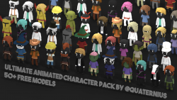</a> <b><a href="animated-characters-pack">Animated Characters Pack</a></b> by quaternius · <a href="https://opengameart.org/content/animated-characters-pack">source</a> |
| <a href="animated-fish">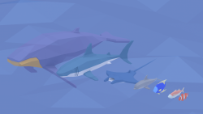</a> <b><a href="animated-fish">Animated Fish</a></b> by quaternius · <a href="https://opengameart.org/content/animated-fish">source</a> |  <b><a href="animated-human-low-poly">Animated Human Low Poly</a></b> by quaternius · <a href="https://opengameart.org/content/animated-human-low-poly">source</a> | <a href="animated-lowpoly-robot">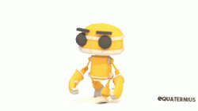</a> <b><a href="animated-lowpoly-robot">Animated LowPoly Robot</a></b> by quaternius · <a href="https://opengameart.org/content/animated-lowpoly-robot">source</a> | <a href="animated-mech-pack">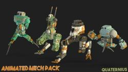</a> <b><a href="animated-mech-pack">Animated Mech Pack</a></b> by quaternius · <a href="https://opengameart.org/content/animated-mech-pack">source</a> |
| <a href="fantasy-low-poly-trees-and-bushes">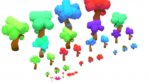</a> <b><a href="fantasy-low-poly-trees-and-bushes">Fantasy Low Poly trees and bushes</a></b> by quaternius · <a href="https://opengameart.org/content/fantasy-low-poly-trees-and-bushes">source</a> | <a href="fantasy-props-megakit">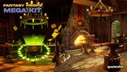</a> <b><a href="fantasy-props-megakit">Fantasy Props MegaKit</a></b> by quaternius · <a href="https://opengameart.org/content/fantasy-props-megakit">source</a> | <a href="furniture-low-poly">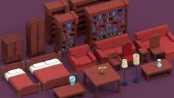</a> <b><a href="furniture-low-poly">Furniture Low Poly</a></b> by quaternius · <a href="https://opengameart.org/content/furniture-low-poly">source</a> | <a href="low-poly-animated-guns">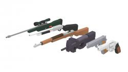</a> <b><a href="low-poly-animated-guns">Low Poly Animated Guns</a></b> by quaternius · <a href="https://opengameart.org/content/low-poly-animated-guns">source</a> |
|  <b><a href="low-poly-cars-0">Low poly Cars</a></b> by quaternius · <a href="https://opengameart.org/content/low-poly-cars-0">source</a> | <a href="low-poly-desert-assets">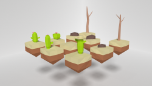</a> <b><a href="low-poly-desert-assets">Low poly desert assets</a></b> by quaternius · <a href="https://opengameart.org/content/low-poly-desert-assets">source</a> | <a href="low-poly-food-pack">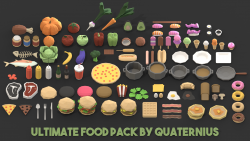</a> <b><a href="low-poly-food-pack">Low Poly Food Pack</a></b> by quaternius · <a href="https://opengameart.org/content/low-poly-food-pack">source</a> | <a href="low-poly-furniture-1">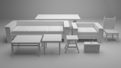</a> <b><a href="low-poly-furniture-1">Low poly furniture</a></b> by quaternius · <a href="https://opengameart.org/content/low-poly-furniture-1">source</a> |
| <a href="low-poly-guns">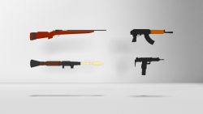</a> <b><a href="low-poly-guns">Low poly Guns</a></b> by quaternius · <a href="https://opengameart.org/content/low-poly-guns">source</a> | <a href="low-poly-guns-pack">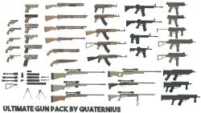</a> <b><a href="low-poly-guns-pack">Low Poly Guns Pack</a></b> by quaternius · <a href="https://opengameart.org/content/low-poly-guns-pack">source</a> | <a href="low-poly-medieval-weapons">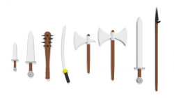</a> <b><a href="low-poly-medieval-weapons">Low poly medieval weapons</a></b> by quaternius · <a href="https://opengameart.org/content/low-poly-medieval-weapons">source</a> | <a href="low-poly-nature-pack-1">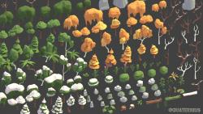</a> <b><a href="low-poly-nature-pack-1">Low Poly Nature Pack</a></b> by quaternius · <a href="https://opengameart.org/content/low-poly-nature-pack-1">source</a> |
| <a href="low-poly-pirate-pack">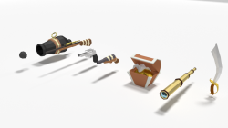</a> <b><a href="low-poly-pirate-pack">Low poly pirate pack</a></b> by quaternius · <a href="https://opengameart.org/content/low-poly-pirate-pack">source</a> | <a href="low-poly-rpg-pack">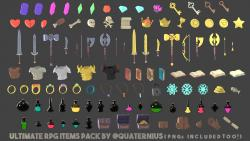</a> <b><a href="low-poly-rpg-pack">Low Poly RPG Pack</a></b> by quaternius · <a href="https://opengameart.org/content/low-poly-rpg-pack">source</a> | <a href="low-poly-space-assets">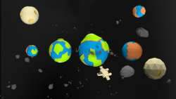</a> <b><a href="low-poly-space-assets">Low poly space assets</a></b> by quaternius · <a href="https://opengameart.org/content/low-poly-space-assets">source</a> | <a href="low-poly-spaceships">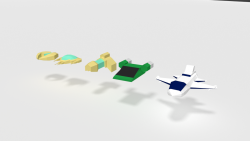</a> <b><a href="low-poly-spaceships">Low poly spaceships</a></b> by quaternius · <a href="https://opengameart.org/content/low-poly-spaceships">source</a> |
| <a href="lowpoly-animated-farm-animal-pack">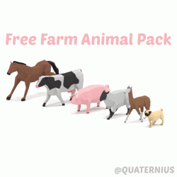</a> <b><a href="lowpoly-animated-farm-animal-pack">LowPoly Animated Farm Animal Pack</a></b> by quaternius · <a href="https://opengameart.org/content/lowpoly-animated-farm-animal-pack">source</a> | <a href="lowpoly-animated-knight">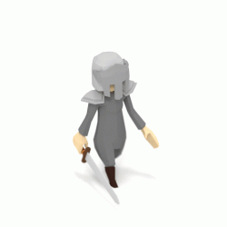</a> <b><a href="lowpoly-animated-knight">LowPoly Animated Knight</a></b> by quaternius · <a href="https://opengameart.org/content/lowpoly-animated-knight">source</a> |  <b><a href="lowpoly-animated-monsters">LowPoly Animated Monsters</a></b> by quaternius · <a href="https://opengameart.org/content/lowpoly-animated-monsters">source</a> |  <b><a href="lowpoly-buildings">LowPoly Buildings</a></b> by quaternius · <a href="https://opengameart.org/content/lowpoly-buildings">source</a> |
| <a href="lowpoly-buildings-pack">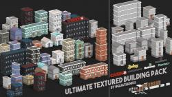</a> <b><a href="lowpoly-buildings-pack">LowPoly Buildings Pack</a></b> by quaternius · <a href="https://opengameart.org/content/lowpoly-buildings-pack">source</a> |  <b><a href="lowpoly-cars">LowPoly Cars</a></b> by quaternius · <a href="https://opengameart.org/content/lowpoly-cars">source</a> | <a href="lowpoly-crops-pack">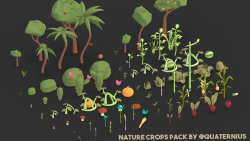</a> <b><a href="lowpoly-crops-pack">LowPoly Crops Pack</a></b> by quaternius · <a href="https://opengameart.org/content/lowpoly-crops-pack">source</a> | <a href="lowpoly-house-interior-pack">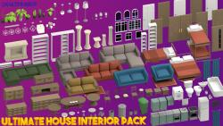</a> <b><a href="lowpoly-house-interior-pack">LowPoly House Interior Pack</a></b> by quaternius · <a href="https://opengameart.org/content/lowpoly-house-interior-pack">source</a> |
| <a href="lowpoly-medieval-buildings">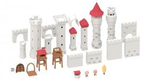</a> <b><a href="lowpoly-medieval-buildings">LowPoly Medieval Buildings</a></b> by quaternius · <a href="https://opengameart.org/content/lowpoly-medieval-buildings">source</a> | <a href="lowpoly-medieval-village-pack">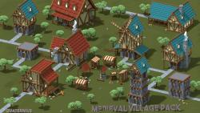</a> <b><a href="lowpoly-medieval-village-pack">LowPoly Medieval Village Pack</a></b> by quaternius · <a href="https://opengameart.org/content/lowpoly-medieval-village-pack">source</a> | <a href="lowpoly-medieval-weapons">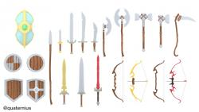</a> <b><a href="lowpoly-medieval-weapons">LowPoly Medieval Weapons</a></b> by quaternius · <a href="https://opengameart.org/content/lowpoly-medieval-weapons">source</a> | <a href="lowpoly-modular-dungeon">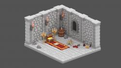</a> <b><a href="lowpoly-modular-dungeon">LowPoly Modular Dungeon</a></b> by quaternius · <a href="https://opengameart.org/content/lowpoly-modular-dungeon">source</a> |
| <a href="lowpoly-modular-dungeon-pack">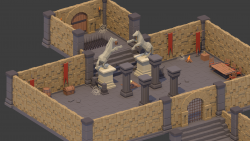</a> <b><a href="lowpoly-modular-dungeon-pack">LowPoly Modular Dungeon Pack</a></b> by quaternius · <a href="https://opengameart.org/content/lowpoly-modular-dungeon-pack">source</a> | <a href="lowpoly-modular-sci-fi-environments">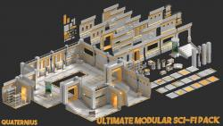</a> <b><a href="lowpoly-modular-sci-fi-environments">LowPoly Modular Sci-Fi Environments</a></b> by quaternius · <a href="https://opengameart.org/content/lowpoly-modular-sci-fi-environments">source</a> | <a href="lowpoly-modular-street-pack">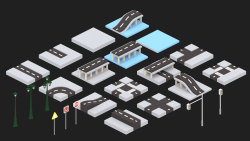</a> <b><a href="lowpoly-modular-street-pack">LowPoly Modular Street Pack</a></b> by quaternius · <a href="https://opengameart.org/content/lowpoly-modular-street-pack">source</a> | <a href="lowpoly-nature-pack">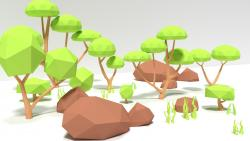</a> <b><a href="lowpoly-nature-pack">LowPoly Nature Pack</a></b> by quaternius · <a href="https://opengameart.org/content/lowpoly-nature-pack">source</a> |
|  <b><a href="lowpoly-posed-humans">LowPoly Posed Humans</a></b> by quaternius · <a href="https://opengameart.org/content/lowpoly-posed-humans">source</a> |  <b><a href="lowpoly-public-transport">LowPoly Public Transport</a></b> by quaternius · <a href="https://opengameart.org/content/lowpoly-public-transport">source</a> | <a href="lowpoly-rpg">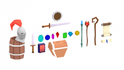</a> <b><a href="lowpoly-rpg">LowPoly RPG</a></b> by quaternius · <a href="https://opengameart.org/content/lowpoly-rpg">source</a> | <a href="lowpoly-rpg-characters">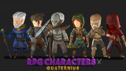</a> <b><a href="lowpoly-rpg-characters">LowPoly RPG Characters</a></b> by quaternius · <a href="https://opengameart.org/content/lowpoly-rpg-characters">source</a> |
|  <b><a href="lowpoly-ship-pack">LowPoly Ship Pack</a></b> by quaternius · <a href="https://opengameart.org/content/lowpoly-ship-pack">source</a> |  <b><a href="lowpoly-spaceships-pack">LowPoly Spaceships Pack</a></b> by quaternius · <a href="https://opengameart.org/content/lowpoly-spaceships-pack">source</a> | <a href="lowpoly-steampunk-turrets">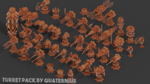</a> <b><a href="lowpoly-steampunk-turrets">LowPoly Steampunk Turrets</a></b> by quaternius · <a href="https://opengameart.org/content/lowpoly-steampunk-turrets">source</a> | <a href="lowpoly-survival-pack">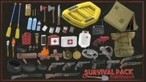</a> <b><a href="lowpoly-survival-pack">LowPoly Survival Pack</a></b> by quaternius · <a href="https://opengameart.org/content/lowpoly-survival-pack">source</a> |
| <a href="lowpoly-textured-trees">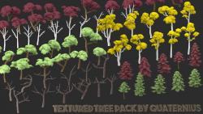</a> <b><a href="lowpoly-textured-trees">LowPoly Textured Trees</a></b> by quaternius · <a href="https://opengameart.org/content/lowpoly-textured-trees">source</a> | <a href="medieval-village-megakit">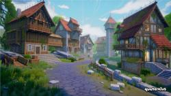</a> <b><a href="medieval-village-megakit">Medieval Village MegaKit</a></b> by quaternius · <a href="https://opengameart.org/content/medieval-village-megakit">source</a> | <a href="modular-sci-fi-megakit">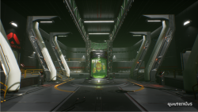</a> <b><a href="modular-sci-fi-megakit">Modular Sci-Fi MegaKit</a></b> by quaternius · <a href="https://opengameart.org/content/modular-sci-fi-megakit">source</a> | <a href="sci-fi-essentials-kit">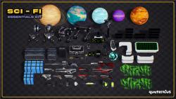</a> <b><a href="sci-fi-essentials-kit">Sci-Fi Essentials Kit</a></b> by quaternius · <a href="https://opengameart.org/content/sci-fi-essentials-kit">source</a> |

---

Kept up to date by this repository's own [update workflow](.github/workflows/update.yml), with code and plan from [cc0-mirror](https://github.com/zuujis-cc0/cc0-mirror). Something wrong? [Open an issue there](https://github.com/zuujis-cc0/cc0-mirror/issues/new) or use the [private report form](https://games.zuujis.com/report).
